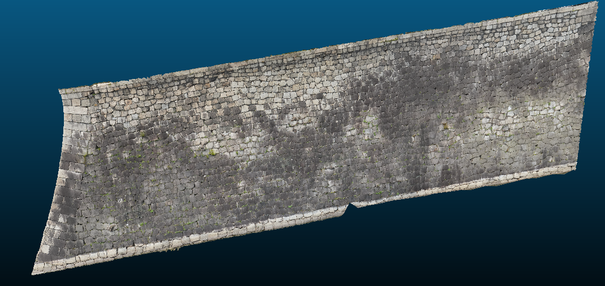
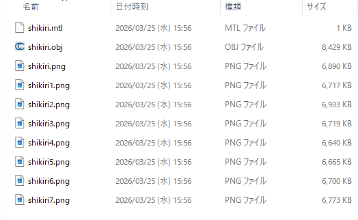
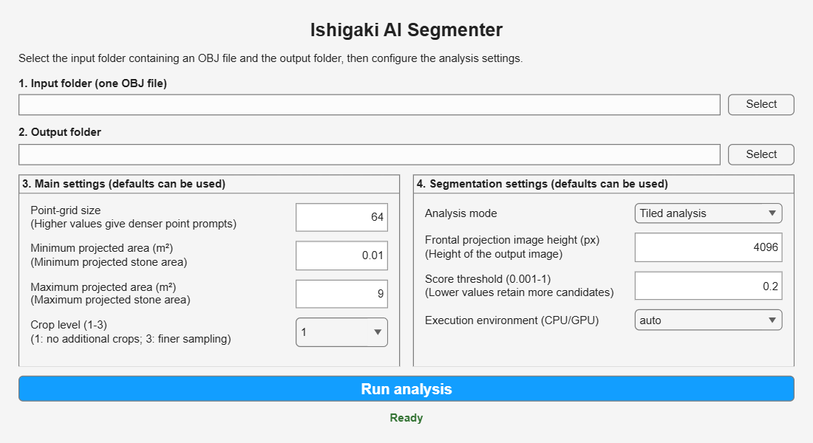

# Ishigaki AI Segmenter

**English** | [日本語](README_JP.md)

ImVisionLabs Inc.

## 1 Introduction

Ishigaki AI Segmenter is a Windows application that extracts individual stone boundaries from textured three-dimensional mesh models of stone walls. It generates a frontal projection image, segments stone regions using AI, reconstructs their boundaries in the original three-dimensional coordinate system, and exports them in Drawing Exchange Format (DXF) for use in CAD software.

Sample data for trying the application are available in [`SampleData/sample-osakacastle/`](SampleData/sample-osakacastle/). The sample data come from the [Stone Wall BIM Project](https://www.nabunken.go.jp/research/stonewallbim.html) at the Nara National Research Institute for Cultural Properties. Download the application from this repository's [Releases](https://github.com/nabunken-info/stone-wall-ai-segmenter/releases) page.

### 1.1 Frontal projection workflow

1. Load an OBJ mesh, its MTL material file, and the associated texture images.
2. Estimate a representative wall plane and generate an orthographic image facing that plane.
3. Segment stone regions in the frontal projection image using the Segment Anything Model (SAM).
4. Reconstruct the extracted boundaries in the original three-dimensional coordinate system using image-to-mesh correspondence information.
5. Save preview images, a DXF file containing three-dimensional stone boundaries, and CSV files recording processing settings and times.

### 1.2 Changes from the trial version

The frontal projection version reconstructs a frontal view of the textured mesh and analyses that image, rather than processing the texture images directly. A stone that spans texture-image boundaries can therefore appear as a continuous region in the frontal projection image, provided that the textures are correctly mapped onto the original mesh. Combining the textures into a single image is optional.

- OBJ files referencing multiple texture images are supported. Textures can be in JPEG and other supported image formats as well as PNG.
- CloudCompare installation and command configuration are no longer required for analysis.
- Crop the input model to the target wall surface before processing. The application does not automatically select a wall from a model of an entire castle site that includes surrounding ground.

## 2 Prepare the input data

### 2.1 Crop the model to a single wall surface

Use mesh-editing software to isolate the wall surface you want to analyse. Remove unrelated geometry wherever possible, including large ground areas, horizontal surfaces at the top of the wall, rear surfaces, buildings, trees, and walls facing other directions. The application cannot reconstruct stones hidden behind vegetation.

Figure 1 shows a mesh cropped to a single wall surface. Keep the target wall and remove the surrounding geometry before preparing the input folder.



Figure 1. Example of a mesh cropped to a single wall surface.

### 2.2 Orientation and coordinate units

Prepare the model with the Z-axis aligned with the real-world vertical direction. The application uses this axis to determine the upward direction in the frontal projection image. Use metres as the coordinate unit so that the projected-area settings in m² correspond to the intended stone sizes.

The exported DXF preserves the coordinate system and units of the input OBJ. Any reference data used to align the results must use the same coordinate system and units.

### 2.3 Input folder structure

Place exactly one OBJ file directly in the input folder. If you have multiple OBJ files, put each model in a separate folder. Keep the OBJ, MTL, and texture images at the same folder level. An OBJ stored only in a subfolder will not be detected.

```text
input_folder/
  wall.obj
  wall.mtl
  texture_01.jpg
  texture_02.png
```

In this example, `wall.obj` references `wall.mtl`, which in turn references `texture_01.jpg` and `texture_02.png` in the same folder.

Figure 2 shows the sample data folder.



Figure 2. Sample data folder structure.

## 3 Installation and basic operation

### 3.1 System requirements and installation

Use the Windows installer with the matching MATLAB Runtime R2026a. You do not need to purchase or install MATLAB itself. MATLAB Runtime provides the environment needed to run the application; the installer downloads it if required. An internet connection is needed for that download.

The application can run on a CPU. To use a GPU, you need a GPU and driver compatible with the distributed application's runtime environment. Memory requirements and processing time depend on the mesh size, image resolution, and segmentation settings.

1. Run `StoneSegmentationApp_Installer.exe`.
2. Follow the installer instructions to choose an installation location and install the matching MATLAB Runtime.
3. Once installation is complete, launch `StoneSegmentationApp.exe`.
4. Wait for the Ishigaki AI Segmenter window to appear. The first launch may take some time.

### 3.2 Select the input and output folders

Figure 3 shows the application interface in English. Select the input and output folders at the top, configure the settings in the middle, and click **Run analysis** at the bottom.



Figure 3. Ishigaki AI Segmenter interface in English.

1. Click **Select** next to **Input folder (one OBJ file)**.
2. Select the input folder prepared as described in Section 2.
3. Create a folder in which to save the results.
4. Click **Select** next to **Output folder** and select that folder.

### 3.3 Configure and run the analysis

1. Review **Main settings** and **Segmentation settings**. See Section 4 for details.
2. For the first run, start with **Tiled analysis** and a crop level of 1. Set the projected-area range to suit the sizes of the stones you want to extract.
3. Click **Run analysis**. Input and settings controls are disabled during processing.
4. When **Analysis complete** appears with the number of extracted stone regions and the DXF save location, open the output folder.
5. Review the images and DXF as described in Section 5. The reported stone count is the number of regions retained by the application; it may differ from the actual number of stones.

A separate run folder is created automatically using the run date and time followed by the OBJ name. A sequential number is added if a folder with the same name already exists. Keep all files from each run together.

## 4 Parameter settings

### 4.1 Main settings

Table 1 lists the main controls and their default values. Projected area means the area seen in the frontal view.

Table 1. Main settings and default values.

| Setting | Default | Description |
|---|---|---|
| Point-grid size | 64 | Controls the density of point prompts in each analysis image. A value of 64 specifies a base grid of 64 × 64 points. Larger values provide denser sampling and increase the processing load. |
| Minimum projected area (m²) | 0.01 m² | Excludes candidates smaller than this area. Lower it to retain smaller stones. |
| Maximum projected area (m²) | 9 m² | Excludes candidates larger than this area. Raise it to retain larger stones. |
| Crop level (1-3) | 1 | Level 1 adds no crops. Level 2 adds a 2 × 2 subdivision; level 3 also adds a 4 × 4 subdivision. Higher levels increase processing time. |

### 4.2 Segmentation settings

Table 2 lists the analysis mode, resolution, and related controls. Increasing the resolution cannot recover detail that is absent from the original textures.

Table 2. Segmentation settings and default values.

| Setting | Default | Description |
|---|---|---|
| Analysis mode | Tiled analysis | Processes the frontal projection image in square tiles. Whole-image analysis is also available. |
| Frontal projection image height (px) / Frontal projection image width (px) | 4096 px | Sets the image height in tiled mode and the image width in whole-image mode. The other dimension is determined by the wall's aspect ratio. |
| Score threshold (0.001-1) | 0.2 | Sets the minimum score for retaining a candidate. Raising it applies stricter filtering; lowering it may increase false detections. |
| Execution environment (CPU/GPU) | `auto` | `auto` selects the environment automatically; `cpu` uses the CPU; `gpu` uses the GPU. |

Set the resolution to an integer of at least 32. The score threshold can be set from 0.001 to 1 in the interface. This score is not a measured segmentation accuracy.

### 4.3 Understanding the two analysis modes

**Tiled analysis** uses square tiles whose side length equals the projection image height. The tiles overlap horizontally, and duplicate candidates in the overlapping areas are removed during processing. This is the default mode for wide wall surfaces.

**Whole-image analysis** processes the entire frontal projection image as one input. Switching to this mode changes the resolution field to **Frontal projection image width (px)**. The displayed value is retained, so a value of 4096 does not produce the same image dimensions in both modes. For a wide wall, whole-image mode produces a smaller image height, which may make small stones harder to distinguish.

The crop level controls additional sampling within SAM, separately from the tiling used by the analysis mode. A crop level of 2 or higher also introduces additional crops in whole-image mode.

## 5 Review the output

Table 3 lists the main output files. Filenames are prefixed with the run date and time. In the table, `<OBJ name>` means the input filename without its extension; it is a placeholder, not a literal part of the filename.

Table 3. Main output files and their uses.

| Filename suffix or location | Contents and use |
|---|---|
| `<OBJ name>_front.png` | Frontal projection image. Check the orientation, coverage, and texture appearance first. |
| `<OBJ name>_sam_overlay.png` | Preview showing the final regions retained for DXF export. |
| `<OBJ name>_boundaries.png` | Preview showing the retained boundaries as red lines. |
| `dxf_output_<OBJ name>.dxf` | Closed three-dimensional polylines in the coordinate system of the input OBJ. |
| `parameters.csv` | Input and output locations and the main analysis settings specified in the interface. |
| `<OBJ name>_audit.csv` | Records of candidate acceptance and rejection, including reasons and projected areas. |
| Files with the `.mat` extension | Processing data, including image-to-mesh correspondence information, extracted regions, and boundaries. |
| Images in the `tiles` folder | Previews for tiled analysis, before results from individual tiles are combined and duplicates are removed. |

CSV files can be opened in Excel or similar software. They use a different format from the configuration Excel files used in earlier versions. You do not need to open the MAT files for routine review of the results.

## 6 Troubleshooting and adjustments

### 6.1 Analysis does not start because of an input error

- **No OBJ file found:** Check that the OBJ is directly inside the selected input folder.
- **Multiple OBJ files found:** Prepare an input folder containing only the model you want to process.
- **Polygon error:** Triangulate the mesh in mesh-editing software and export it again.
- **Segmentation model not found:** Check for missing application files and contact the distributor.

### 6.2 The orientation or projected extent looks wrong

Check for geometry outside the target wall, surfaces facing other directions, an incorrect Z-axis orientation, and reversed faces. Crop the model to the target wall surface and run the analysis again. The GUI does not provide a control for manually setting the projection direction.

### 6.3 Too many stones are missed or incorrectly extracted

1. Check the frontal projection image and confirm that the model's coordinate units are metres.
2. If small stones are missing, check the minimum projected area. If large stones are missing, check the maximum projected area.
3. If stones are still missed, adjust the point-grid size, image resolution, and crop level one at a time.
4. If there are many false detections, remove unrelated geometry from the input model and adjust the area limits or score threshold.
5. Compare the preview images and `parameters.csv` from each run to choose settings suited to your wall.

Area limits and score thresholds may not resolve cases where one stone is split into several regions or several stones are grouped into one. Inspect the final boundaries and correct them manually as needed.

### 6.4 Out-of-memory or GPU errors

If the point-grid size is set to a large value such as 64, try lowering it to 32 and setting the crop level to 1. For GPU errors, try setting the execution environment to `cpu`. CPU processing still requires enough memory for the model. Processing time varies with the system and settings, so a period without a visible update does not necessarily mean that processing has failed.

## Version history

- 30 October 2026: Version 2.0 created.
