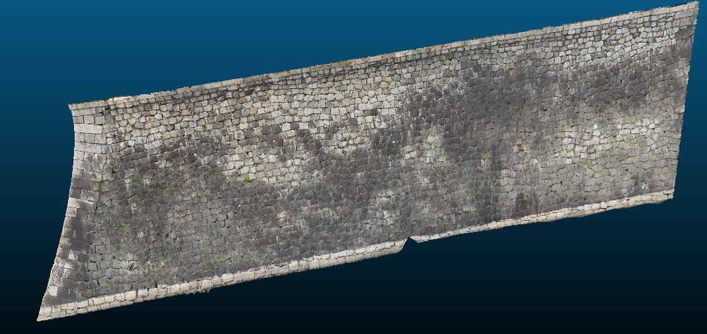
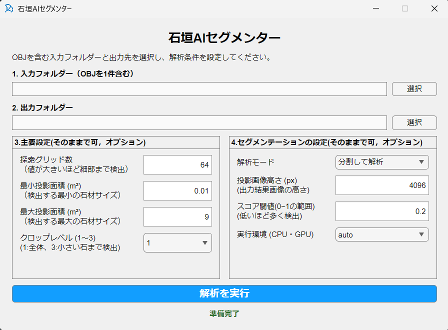

# 石垣AIセグメンターについて

ImVisionLabs株式会社

## 1 はじめに

　本アプリケーションは、テクスチャ付きの3次元メッシュモデルから石垣の正面画像を生成し、AIによって石材の領域を抽出するWindows向けアプリケーションです。抽出した輪郭を元の3次元座標へ戻し、CADで利用できるDXF形式で保存します。

### 1.1 投影版の処理の流れ

1. OBJ、MTL、テクスチャ画像を読み込みます。
2. 壁面を代表する平面を推定し、その面に正対した正投影画像を生成します。
3. 正投影画像に対してSAMによる石材領域の抽出を行います。
4. 画像とメッシュの対応を使い、輪郭を元の3次元座標に復元します。
5. 確認用画像、3次元輪郭のDXF、設定・判定記録などを保存します。

### 1.2 試験版から変わった点

　投影版は、展開されたテクスチャ画像を直接解析するのではなく、メッシュ上の模様を壁面の正面画像として再構成して解析します。そのため、石材がテクスチャ画像の継ぎ目にまたがっていても、元のメッシュ上で正しく貼られていれば、投影画像上では連続した見た目として扱えます。テクスチャを1枚にまとめる作業は必須ではありません。

- 複数のテクスチャ画像を参照するOBJを扱えます。画像形式もPNGだけに限定されず、JPEGなどを利用できます。
- 解析処理のためのCloudCompareのインストールや実行コマンド設定は不要です。
- 一方、入力はあらかじめ対象の壁面だけに切り出してください。地面を含む城郭全体から目的の壁面を自動選択するアプリケーションではありません。


## 2 入力データの準備

### 2.1 対象の壁面だけを残す

　メッシュ編集ソフトなどで、解析したい一つの壁面を切り出してください。広い地面、天端の水平面、背面、建物、樹木、別方向を向く壁面など、対象外の形状はできるだけ除去します。植生が壁面を覆っている場合、隠れた石材の形状を復元することはできません。


　一つの壁面だけに切り出したメッシュモデルの例を図1に示します。解析対象の壁面を残し、周囲の不要な形状を取り除いた状態で入力データを準備してください。



図1　一つの壁面だけに切り出したメッシュモデルの例

### 2.2 向きと座標単位

　Z軸が実世界の鉛直方向になるように準備してください。投影画像の上方向を決めるためにZ軸を使用します。DXFは入力OBJの座標系で出力されます。位置合わせに使用する元データも、同じ座標系・単位でそろえてください。

### 2.4 フォルダーの配置

　選択する入力フォルダーの直下にOBJを1件だけ置きます。OBJが複数ある場合は、対象ごとにフォルダーを分けてください。サブフォルダーの中だけにOBJを置いても検出されません。配置例を以下に示します。

```text
入力フォルダー/
  wall.obj
  wall.mtl
  textures/
    texture_01.jpg
    texture_02.png
```

　上の例では、wall.objがwall.mtlを参照し、wall.mtlがtextures内の画像を参照します。画像をサブフォルダーに置く場合も、参照先の相対パスを保ってください。

## 3 インストールと基本操作

### 3.1 実行環境とインストール

　配布用Windowsインストーラーと、それに対応するMATLAB Runtimeを使用します。MATLAB本体の購入・インストールは不要です。Runtimeはアプリを動かすための実行環境で、インストーラーから必要に応じて取得します。その際はインターネット接続が必要です。

　CPUでの解析も可能です。GPUを使用する場合は、配布版の実行環境に対応したGPUとドライバーが必要です。必要なメモリ量や処理時間は、メッシュ規模、画像解像度、探索条件によって変わります。

1. 配布されたStoneSegmentationApp_projection_Installer.exeを起動します。
2. 画面の案内に従ってインストール先を指定し、対応するMATLAB Runtimeをインストールします。
3. 完了後、インストールされたStoneSegmentationApp_projection.exeを起動します。
4. 「石垣AIセグメンター投影版」の画面が表示されるまで待ちます。初回は準備に時間がかかることがあります。

### 3.2 入力先と出力先を選ぶ

　アプリの操作画面を図2に示します。画面上部で入力フォルダーと出力フォルダーを選び、中央で解析条件を設定した後、下部の「解析を実行」を押します。



図2　石垣AIセグメンターの操作画面

1. 「入力フォルダー（OBJを1件含む）」の「選択」を押します。
2. 第2章に従って準備した入力フォルダーを選択します。
3. 結果の保存先フォルダーをあらかじめ作成します。
4. 「出力フォルダー」の「選択」を押し、保存先を選択します。

### 3.3 条件を設定して実行する

1. 「主要設定」と「セグメンテーションの設定」を確認します。各項目は第4章を参照してください。
2. 初回は「分割して解析」とクロップレベル1を基本とし、対象の石材サイズに合う投影面積の範囲を指定します。
3. 「解析を実行」を押します。解析中は入力や設定の操作が無効になります。
4. 「解析完了」と、抽出石材数・DXFの保存先が表示されたら、出力フォルダーを開きます。
5. 第5章の順序で画像とDXFを確認します。抽出石材数はアプリが採用した領域数であり、実際の石材数との一致を保証しません。

　出力先には「実行日時_OBJ名」のフォルダーが自動作成されます。同名の実行フォルダーがある場合は連番が付きます。実行ごとのフォルダーをまとめて保存してください。

## 4 パラメータの設定

### 4.1 主要設定

　画面上の名称と初期値を表1に示します。投影面積は正面から見た面積です。

表1　主要設定の初期値と役割

| 項目 | 初期値 | 役割 |
|---|---|---|
| 探索グリッド数 | 64 | 各解析画像に配置する探索点の密度。64は基本となる縦64点×横64点の配置を表します。増やすと探索が細かくなる一方、処理負荷が増えます。 |
| 最小投影面積 | 0.01 m² | この面積より小さい候補を除外します。小さい石材を残す場合は下げます。 |
| 最大投影面積 | 9 m² | この面積より大きい候補を除外します。大きい石材を扱う場合は上げます。 |
| クロップレベル | 1 | 1は追加分割なし。2は2×2、3はさらに4×4の追加探索を行います。値を上げると処理時間が増えます。 |


### 4.2 セグメンテーションの設定

　解析モードや解像度などの設定を表2に示します。解像度を上げるだけで、元のテクスチャにない細部が復元されることはありません。

表2　セグメンテーション設定の初期値と役割

| 項目 | 初期値 | 役割 |
|---|---|---|
| 解析モード | 分割して解析 | 投影画像を正方形の領域に分けて解析します。「全体を1枚で解析」も選択できます。 |
| 投影画像高さまたは横幅 | 4096 px | 分割モードでは高さ、全体1枚モードでは横幅を指定します。もう一方は対象の縦横比から決まります。 |
| スコア閾値 | 0.2 | 候補を採用するためのスコアの下限。上げると候補を厳しく絞り、下げると誤抽出も増える場合があります。 |
| 実行環境 | auto | autoは自動選択、cpuはCPU、gpuはGPUを指定します。 |

　解像度は32以上の整数、スコア閾値は画面で指定できる0.001～1の範囲で設定します。スコアは実測した正解率ではありません。

### 4.3 二つの解析モード

　「分割して解析」は、投影画像の高さを基準に正方形の領域を作り、横方向に重ねながら解析します。分割間の重複は処理中に整理されます。横長の壁面を扱う際の基本モードです。

　「全体を1枚で解析」は、投影画像全体を一つの入力として解析します。モードを切り替えると、解像度欄は「投影画像横幅 (px)」に変わります。表示中の数値は引き継がれるため、同じ4096でも分割モードと同じ解像度にはなりません。横長の壁面では高さが小さくなり、小さい石材が見えにくくなる場合があります。

　クロップレベルは、解析モードによる分割とは別の追加探索です。「全体を1枚で解析」でも、クロップレベルを2以上にするとSAM内部の追加分割を行います。

## 5 出力結果の確認

　主な出力を表3に示します。ファイル名の先頭には実行日時が付きます。表中の「OBJ名」は入力ファイル名から拡張子を除いた名称です。

表3　主な出力ファイルと用途

| ファイル名の末尾 | 内容と用途 |
|---|---|
| OBJ名_front.png | 正面投影画像。向き、範囲、テクスチャの状態を確認します。 |
| OBJ名_sam_overlay.png | 最終的にDXFへ採用した領域を重ねた確認画像です。 |
| OBJ名_boundaries.png | 採用した輪郭を赤線で示した確認画像です。 |
| dxf_output_OBJ名.dxf | 元のOBJ座標系による閉じた3次元ポリラインです。 |
| parameters.csv | 入出力先、画面で指定した主要な解析条件を保存します。 |
| OBJ名_audit.csv | 候補の採用・除外理由や投影面積を確認する記録です。 |
| 拡張子が.matのファイル | 画像と3次元の対応、抽出領域、輪郭などの処理データです。 |
| tilesフォルダー内の画像 | 分割解析時の確認画像。分割間の統合・重複除去前の結果です。 |

　CSVはExcelなどで確認できます。従来版の設定用Excelファイルとは形式が異なります。MATは通常の結果閲覧で開く必要はありません。

## 6 困ったときの確認と調整

### 6.1 入力エラーで開始できない

- OBJが見つからない場合：選択フォルダーの直下にOBJがあるか確認します。
- OBJが複数ある場合：処理する1件だけを残した入力フォルダーを用意します。
- 多角形のエラーが出る場合：メッシュ編集ソフトで三角形化して再出力します。
- モデルが見つからない場合：配布ファイルの欠落を確認し、配布元へ問い合わせます。

### 6.2 向きや表示範囲がおかしい

　壁面以外の形状、別方向の面、Z軸の向き、面の表裏を確認します。対象壁面だけに切り出し直したうえで、再解析してください。GUIから投影方向を手動指定することはできません。

### 6.3 石材の見落としや誤抽出が多い

1. まず投影画像の見え方と、座標単位がメートルであることを確認します。
2. 小さい石材が抜ける場合は最小投影面積、大きい石材が抜ける場合は最大投影面積を確認します。
3. 見落としが残る場合は、探索グリッド数、解像度、クロップレベルを一つずつ調整します。
4. 誤抽出が多い場合は、入力モデルの不要部分を除き、面積条件やスコア閾値を調整します。
5. 各実行の画像とparameters.csvを比較し、対象に適した条件を選びます。

　面積やスコアだけでは分割・結合の誤りを必ず解消できません。最終的に必要な境界を、人が点検・修正してください。

### 6.4 メモリ不足やGPUエラーが出る

　探索グリッド数（グリッドサイズ）を64などの大きい値に設定している場合は、32などの小さい値に下げ、クロップレベルを1にして試します。GPU関連のエラーでは、実行環境をcpuに変更して確認できます。ただし、CPUでもモデル規模に応じたメモリが必要です。処理時間は環境と条件によって変わるため、表示が変わらない時間だけで失敗とは判断しないでください。


## バージョン履歴

- 2026年10月30日：バージョン2.0を作成。


